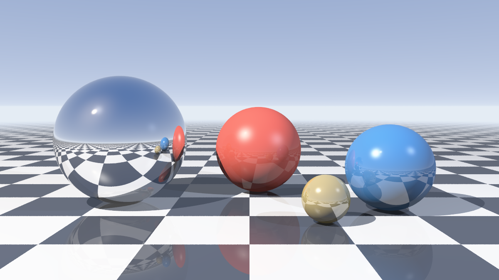
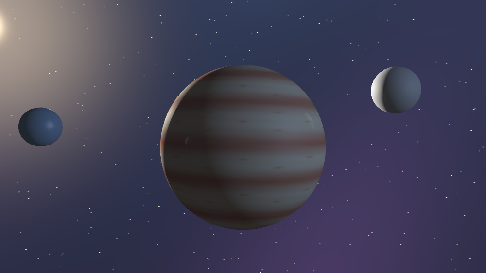
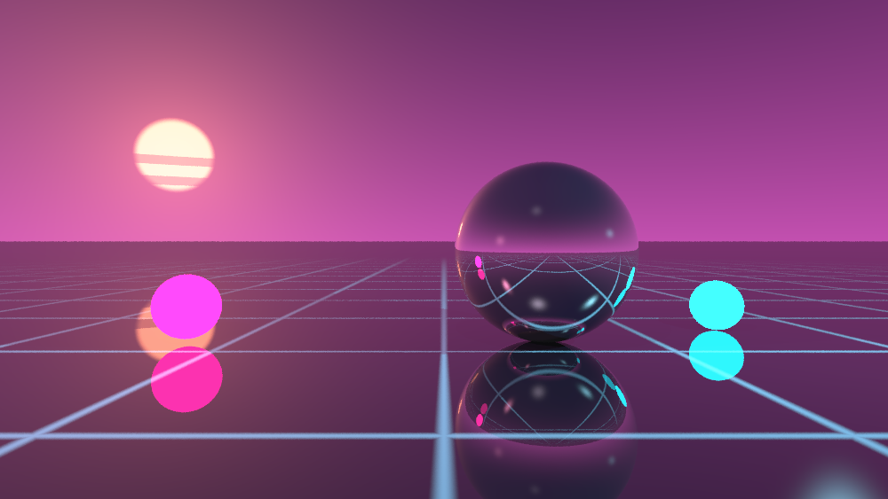

<h1 align="center">tiny-ray</h1>

<p align="center">
  <em>一个零依赖的迷你光线追踪器：渲染到终端、PNG 或 PPM。</em>
</p>

<p align="center">
  <a href="https://github.com/xhxmn/tiny-ray/actions/workflows/ci.yml"></a>
  
  = 18" src="https://img.shields.io/badge/node-%3E%3D18-brightgreen.svg">
  
</p>



<p align="center"><a href="README.md">English</a> · <strong>简体中文</strong></p>

---

`tiny-ray` 是一个用纯 ES Module 写成的小型渲染器：没有依赖、不需要构建、
没有原生扩展。它支持球体与平面求交、硬阴影、Blinn-Phong 高光、递归镜面反射
和距离雾，然后把画面用 24 位真彩半格字符打印到终端，或者写成 PNG / PPM 文件。

它刻意做得很小：约 1300 行可读的 JavaScript，其中大部分是注释和 JSDoc。
场景就是普通的 JavaScript 对象，几行就能描述，再几行就能渲染。

## 特性

- **零依赖。** 不用安装，不用编译。
- **四种输出。** 真彩 ANSI 半格字符（一个字符格装两个像素行）、纯 ASCII、
  PNG（手写编码器，zlib + CRC32）以及 PPM。
- **三个内置场景。** 经典棋盘格、条纹气态巨行星、合成器浪潮网格——
  每个都只是一小段可随意修改的数据。
- **正经的着色。** 环境光 + Lambert 漫反射 + Blinn-Phong 高光、硬阴影射线、
  递归反射、距离雾。
- **过程化材质。** 纯色、棋盘格，或者任何能用“表面点 → 颜色”函数表达的东西。
- **可复现。** 采样抖动使用带种子的随机数，同一个种子永远得到完全相同的图，
  截图和测试都不会漂移。
- **有测试。** 使用内置 `node:test` 的 57 个测试，外加一份 CI 工作流。

## 环境要求

Node.js 18 或更高版本。就这些。

## 快速开始

```bash
git clone https://github.com/xhxmn/tiny-ray.git
cd tiny-ray

# 在终端里渲染默认场景
node bin/tiny-ray.js

# 或者输出一张 1200×675 的图片
node bin/tiny-ray.js --scene neon --width 1200 --height 675 --samples 8 --out neon.png
```

可选：把 `tiny-ray` 命令装到全局。

```bash
npm link        # 之后可以直接用：tiny-ray --scene planets
```

## 用法

```
tiny-ray [options]

Scenes
  spheres   Checkerboard floor, chrome / matte / glassy spheres, daylight sky.
  planets   Gas giant with banded clouds, moons, and a hashed starfield.
  neon      Synthwave sunset over an infinite glass grid, with chrome.

Scene options
  -s, --scene <name>    scene to render                    (default: spheres)
      --width <px>      image width                        (default: terminal width)
      --height <px>     image height                       (default: derived from 16:9)
      --samples <n>     jittered samples per pixel         (default: 2, or 4 with --out)
      --depth <n>       reflection bounces                 (default: 4)
      --seed <n>        random seed; same seed, same image (default: 1)
      --exposure <x>    exposure multiplier                (default: from the scene)

Output
  -o, --out <file>      write a .png (or .ppm) file instead of the terminal
      --ascii           plain ASCII ramp, no colour
      --no-color        disable 24 bit colour
      --color           force 24 bit colour

Other
  -l, --list            list the built-in scenes
  -v, --version         print the version
  -h, --help            print this help
```

### 几个例子

```bash
# 终端里快速预览（半格字符，24 位真彩）
node bin/tiny-ray.js --width 100

# 单调终端或日志文件里用的 ASCII 图
node bin/tiny-ray.js --scene planets --ascii --width 80

# 高质量静帧，反射深度 12
node bin/tiny-ray.js --scene spheres --width 1600 --height 900 --samples 16 --depth 12 --out sphere.png

# 不走命令行，直接调用 API
node -e "import('./src/index.js').then(m => m.writeImage('x.ppm', m.render(m.getScene('neon'), { width: 320, height: 180 })))"
```

`--out` 会自动创建缺失的目录，并根据扩展名选择 PNG 或 PPM
（除 `.ppm` 之外一律写成 PNG）。

## 内置场景

| 场景      | 内容                                                                        |
| --------- | --------------------------------------------------------------------------- |
| `spheres` | 无限棋盘地面、铬球、哑光球与高光球，日光天空加距离雾。                       |
| `planets` | 带过程化云带的气态巨行星、两颗卫星、哈希生成的星空，以及低垂的太阳。         |
| `neon`    | 合成器浪潮落日、自发光球体、镜面地面与无限延伸的霓虹网格。                   |

<p align="center">
  
  
</p>

三张预览图都是项目自己渲染的：

```bash
node scripts/render-gallery.js
```

## 编程接口

```js
import { Vec3, render, writeImage } from './src/index.js';

const scene = {
  camera: { eye: new Vec3(0, 1.3, 5), target: new Vec3(0, 0.85, 0), fov: 42 },
  objects: [
    {
      kind: 'plane',
      point: new Vec3(0, 0, 0),
      normal: new Vec3(0, 1, 0),
      material: {
        checker: { scale: 1, colorA: new Vec3(0.9, 0.9, 0.92), colorB: new Vec3(0.12, 0.13, 0.16) },
        ambient: 0.08, diffuse: 0.85, specular: 0.3, shininess: 180, reflect: 0.2,
      },
    },
    {
      kind: 'sphere',
      center: new Vec3(0, 0.9, 0),
      radius: 0.9,
      material: { color: new Vec3(0.2, 0.55, 0.75), ambient: 0.05, diffuse: 0.6,
                  specular: 0.9, shininess: 350, reflect: 0.35 },
    },
  ],
  lights: [{ position: new Vec3(3, 5, 4), intensity: 1.8 }],
  background: () => new Vec3(0.55, 0.7, 0.92),
  fog: { color: new Vec3(0.72, 0.8, 0.93), near: 18, far: 55 },
  exposure: 1.0,
};

const image = render(scene, { width: 800, height: 450, samples: 8, seed: 1 });
writeImage('custom.png', image); // 写 PNG；用 .ppm 则写 PPM
```

完整可运行的版本在 [`examples/custom-scene.js`](examples/custom-scene.js)：

```bash
node examples/custom-scene.js
```

### 场景结构

| 字段 | 类型 | 说明 |
| --- | --- | --- |
| `camera.eye`、`camera.target` | `Vec3` | 相机位置与看向的点。 |
| `camera.fov` | `number` | 垂直视场角（度）。 |
| `objects[]` | `object[]` | `{ kind: 'sphere', center, radius, material }` 或 `{ kind: 'plane', point, normal, material }`；平面无限大且双面可见。 |
| `lights[]` | `object[]` | `{ position, color?, intensity? }`，点光源，硬阴影。 |
| `background` | `(direction: Vec3) => Vec3` | 逃逸射线看到的颜色。 |
| `fog` | `{ color, near?, far? }` | 可选，按距离把表面颜色混向 `color`。 |
| `exposure` | `number` | 可选，色调映射前的曝光倍数。 |

### 材质

| 字段 | 含义 |
| --- | --- |
| `color` | 基础反射率，大致在 `0..1` 的 `Vec3`。 |
| `emissive` | 若设置，该表面忽略光照直接返回这个颜色（太阳、霓虹灯）。 |
| `checker` | `{ scale, colorA, colorB }`，铺在 XZ 平面上的棋盘格。 |
| `pattern` | `(point, normal) => Vec3`，过程化材质；优先级高于 `checker`。 |
| `ambient` | 环境光权重，默认 `0.08`。 |
| `diffuse` | Lambert 漫反射权重，默认 `0.9`。 |
| `specular`、`shininess` | Blinn-Phong 高光权重与指数。 |
| `reflect` | `0..1` 的镜面权重，反射最多递归 `maxDepth` 层。 |

### `render(scene, options)`

| 选项 | 默认值 | 含义 |
| --- | --- | --- |
| `width`、`height` | `320`、`180` | 输出像素尺寸。 |
| `samples` | `2` | 每像素抖动采样数；为 1 时等于不做抗锯齿。 |
| `maxDepth` | `4` | 最大反射次数。 |
| `seed` | `1` | 随机数种子；种子与选项相同则输出逐字节一致。 |
| `exposure` | 场景中的值 | 覆盖 `scene.exposure`。 |
| `onProgress` | — | `(row, rows) => void`，每渲染完一行调用一次。 |

返回 `{ width, height, data }`，其中 `data` 是逐行排列的 RGB `Uint8Array`。

## 实现思路

1. **相机。** 由 eye、target、up 构造正交基；每个像素在像素内部抖动取一条射线，
   `--samples` 就是在平均这些样本。
2. **求交。** 球体用一元二次方程，平面用点积。取最近的正向交点，并把法线翻转到
   朝向入射射线的方向。
3. **着色。** 先加环境光，再对每个光源投射阴影射线，叠加 Lambert 漫反射和
   Blinn-Phong 高光；带反射的材质沿着镜像方向递归。
4. **雾。** 按距离把表面颜色混向雾色——这同时也能掩盖无限延伸地面的锯齿噪点。
5. **色调映射。** `0.8` 以下保持线性，以上用指数肩部把高光平滑压向白色而不是
   直接削平；最后做 `1/2.2` 的 gamma。
6. **输出。** RGB 缓冲区变成半格字符（每个字符格一个前景色、一个背景色）、
   ASCII 灰阶，或者完全手写的 PNG：签名、`IHDR`、deflate 压缩的 `IDAT`、`IEND`，
   每块都带 CRC32。

## 项目结构

```
tiny-ray/
├── bin/tiny-ray.js        # 可执行入口
├── src/
│   ├── cli.js             # 参数解析、帮助、进度与输出
│   ├── render.js          # 像素循环、采样、色调映射
│   ├── tracer.js          # 着色、阴影、反射、雾
│   ├── geometry.js        # 球/平面求交、最近交点、材质解析
│   ├── camera.js          # 相机基与射线生成
│   ├── scenes.js          # 三个内置场景
│   ├── terminal.js        # 半格与 ASCII 渲染
│   ├── png.js             # PNG/PPM 编码、CRC32
│   ├── rng.js             # 带种子的随机数与哈希
│   ├── vec3.js            # 向量类型
│   └── index.js           # 公共 API
├── scripts/render-gallery.js
├── examples/custom-scene.js
├── test/                  # 57 个测试，基于 node:test
└── docs/                  # README 用到的预览图
```

## 开发

```bash
npm test                         # 运行测试（node --test）
node scripts/render-gallery.js   # 重新生成 docs/ 下的所有图片
```

Node 自带的测试运行器不需要任何配置或依赖——开发和运行本项目都不需要
`npm install`。

### 性能

渲染是单线程 JavaScript，每个样本（包含它派生的阴影与反射射线）大约 0.5–1 µs。
README 里的几张图耗时：

| 图片 | 尺寸 | 采样 | 耗时 |
| --- | --- | --- | --- |
| `docs/demo.png` | 1200×675 | 16 | 约 11 秒 |
| `docs/planets.png` | 1000×563 | 8 | 约 2 秒 |
| `docs/neon.png` | 1000×563 | 8 | 约 3 秒 |

100×56 的终端预览不到一秒。

## 许可证

[MIT](LICENSE)，随便用。
